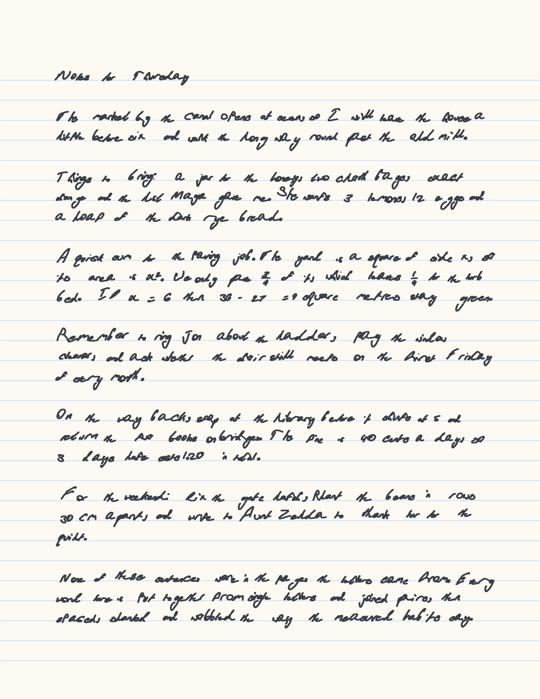

# Handwriter

Writes typed text in your own handwriting: first as an on-screen stroke-by-stroke preview, then on paper with a pencil or pen held on a Bambu Lab P1S.

What works today: a letter library traced from photographed alphabet pages writes exactly what is typed, in the measured habits of the hand; the page becomes a `.gcode.3mf` that Bambu Studio sends to the P1S; a pencil guide for Falu's modular head mount is designed and checked on screen. What has not happened yet: nothing has run on the real printer, the holder has not been printed, and the blind test against real writing has not been run.

## Demo

```
python demo/run_demo.py
```

runs the whole chain on a letter-size page of text that was never in the source pages and writes everything to `demo/out/` (open `demo/out/index.html`, or `http://localhost:8000/demo/` while the server runs):

1. the typed text is laid out and written with the letter library (`1_page.png`, and `2_writing.gif` stroke by stroke);
2. the page is placed on the P1S plate with the pencil-holder clearances, split into two passes and written to two dry-run `.gcode.3mf` files that pass the safety simulation (`3_on_the_plate.png`);
3. the page is redrawn from nothing but the G-code and compared with the original, as proof that the files say what the page says (`4_read_back_from_gcode.png`, worst deviation 0.07 mm);
4. the pencil guide is seated in Falu's head mount with his spring module and a pencil and checked for collisions (`5_pencil_holder.png`).

`python demo/make_video.py` renders the same chain as a 95-second video, `demo/out/demo.mp4`: the text being typed, the page being written stroke by stroke, then a simplified 3D model of the P1S (`demo/printer_scene.py`) seen from outside and inside while it is driven by the real plotter files: homing pause, fitting the holder and pencil on the 10 mm block, both passes with the paper turned in between, then the read-back comparison and the holder. It is a simulation, not footage of the printer; the printer model is hand-built from boxes, Falu's mount and spring module are his real files, and where the pencil sits relative to the nozzle (32 mm left, 36 mm in front) is estimated from the shape of his mount until it is calibrated.

The script exits with an error if a character has no sample, a file fails the safety check, or the read-back drifts more than 0.2 mm. `report.json` holds the numbers.



## Credits

- **Pencil holder hardware: Falu Mendy Vergara** ([@FaluMendy](https://makerworld.com/en/models/2029113-modular-system-for-a1-p1-x1-series)), "Modular System For A1, P1, & X1 Series" (UMTS). The head mount and spring modules in `hardware/falu/` are his files, unchanged, kept here for personal use under his MakerWorld licence; see `hardware/falu/README.md`. The pencil guide in `hardware/out/` copies the outside of his tool guide so that it fits his mount, and the clearances in the Plotter tab's preset come from his tested P1S profile.
- **P1S setup guide for that system:** [rebelthor/bambu-lab-pen-plotter](https://github.com/rebelthor/bambu-lab-pen-plotter) (MIT).
- **P1S plotting approach and printer profile:** [gtls64/p1s-pen-plotter](https://github.com/gtls64/p1s-pen-plotter) (MIT); its profile and licence are in `ml/weights/bambu/`.
- **Base handwriting network:** [X-rayLaser/pytorch-handwriting-synthesis-toolkit](https://github.com/X-rayLaser/pytorch-handwriting-synthesis-toolkit) (MIT); weights and licence in `ml/weights/base/`.
- **Photo tracing:** Google's InkSight (Apache-2.0). **Reading handwriting:** Microsoft TrOCR and EasyOCR.

## Model choices

| Role | Choice | Licence | Why |
|---|---|---|---|
| Text to strokes | Graves-style attention LSTM + mixture density network, weights from [X-rayLaser/pytorch-handwriting-synthesis-toolkit](https://github.com/X-rayLaser/pytorch-handwriting-synthesis-toolkit) (`checkpoints/Epoch_56`) | MIT | PyTorch, English weights, emits pen offsets for a whole line, trains on plain (strokes, transcript) pairs, 15 MB, runs on CPU/MPS/CUDA |
| Photo to ink | [InkSight Small-p](https://huggingface.co/Derendering/InkSight-Small-p) | Apache-2.0 | Public weights, word-level "recognize and derender" returns transcript and strokes |
| Recognizer for CER | [microsoft/trocr-small-handwritten](https://huggingface.co/microsoft/trocr-small-handwritten) | MIT | Independent judge of legibility on rendered lines |

The base weights were trained by their author on IAM-OnDB, which is licensed for non-commercial research. The code and weight files are MIT, but treat anything derived from them as personal-use.

`ml/hw/model.py` is a re-implementation whose parameter names match the published checkpoint, so the weights load directly. It adds batched sampling, masked loss, stall detection, style priming and character-set extension.

## Layout

```
app/            React + TypeScript UI (capture, write preview, photo review, worksheet, blind test, training)
app/src/script.json   65 prompted lines: 60 for training, 5 held out
ml/hw/          model, dataset, training, evaluation, layout layer, worksheet, photo-to-ink, API server
ml/weights/base/      MIT base checkpoint, stats, licence
ml/inksight_worker.py runs in its own TensorFlow environment
data/           sessions, photo words, checkpoints, reports (created at runtime)
```

## Running it on a Mac (or any laptop) without the PC

Everything needed to write pages and make plotter files runs on a Mac with no admin password, no graphics card and no Node.js: the built web app is committed in `app/dist`, and `mac/setup.sh` installs [uv](https://github.com/astral-sh/uv) into your home folder, uses it to fetch Python 3.12 into `~/.venvs/handwriter`, installs the short package list in `ml/requirements-mac.txt`, saves the Falu pencil-holder settings to `data/plotter.json` if there are none yet, and writes a test line to prove the letter library loads.

1. On github.com, signed in, open the repository and choose Code, Download ZIP. Unzip it (or `git clone` it if git is set up).
2. Open Terminal in that folder (Finder: right-click the folder, Services, New Terminal at Folder) and run `bash mac/setup.sh`. A few minutes the first time.
3. Run `bash mac/start.sh`. The browser opens at `http://localhost:8000`. Close the Terminal window to stop it. After the first time, `mac/Start Handwriter.command` does setup and start with a double-click (if macOS blocks it, right-click it and choose Open, or keep using Terminal).
4. Send the files to the printer with Bambu Studio for Mac, signed in to the printer's account.

What stays on the PC: Photo review (InkSight needs the PC's GPU through WSL), training, and reading text on Copy a page (EasyOCR and TrOCR are not in the Mac package list; drawings and typed corrections still work). Calibration lives in `data/plotter.json` on whichever machine you use; copy that file across if you move, and keep it when you download a newer ZIP. Tested by a clean install on Linux (Ubuntu in WSL), not on a Mac.

## Running it

Windows PC (training and serving):

```
python -m venv C:\Users\<you>\.venvs\handwriter
C:\Users\<you>\.venvs\handwriter\Scripts\pip install torch --index-url https://download.pytorch.org/whl/cu128
C:\Users\<you>\.venvs\handwriter\Scripts\pip install -r ml\requirements.txt
cd app && npm install && npm run build && cd ..
C:\Users\<you>\.venvs\handwriter\Scripts\python -m uvicorn hw.server:app --app-dir ml --host 0.0.0.0 --port 8000
```

Open `http://<pc-ip>:8000` on the iPad or the Wacom machine. Browsers only expose the full pen sample rate (coalesced events) on a secure page, so for an iPad add `--ssl-keyfile key.pem --ssl-certfile cert.pem` with a self-signed certificate and open `https://<pc-ip>:8000`; over plain http the page still works at the display refresh rate. Keep the virtual environment on a short path; PyTorch does not install under very long Windows paths.

MacBook (inference only): `pip install torch -r ml/requirements.txt`, copy `data/checkpoints/` across, run the same uvicorn command. Generation defaults to CPU, which is faster than a GPU for this small recurrent model; set `HW_DEVICE=mps` to try MPS.

InkSight needs TensorFlow with tensorflow-text, which has no Windows build, so on Windows the server calls it through WSL at `~/inksight-venv`. Use TensorFlow 2.21 with its CUDA extras: on this PC the RTX 5060 Ti takes about 4 seconds per word, 2.20 cannot drive the card, and CPU inference takes several minutes per word.

```
wsl -e bash -lc "python3 -m virtualenv ~/inksight-venv && ~/inksight-venv/bin/pip install 'tensorflow[and-cuda]==2.21.0' tensorflow-text==2.21.1 huggingface_hub pillow numpy"
```

On macOS/Linux create `~/inksight-venv` the same way, or set `HW_INKSIGHT_PYTHON` to another interpreter. `HW_INKSIGHT_MODEL` can point at a local SavedModel folder instead of the Hugging Face id.

## How the pieces work

**Capture.** Pointer events (coalesced where the browser allows) record x and y in millimetres, time in ms, pressure and tilt. Millimetres come from a one-off calibration against a bank card. Each saved line autosaves to the server; the session exports as JSON and as a zip of IAM-OnDB-style stroke XML (integer coordinates in 0.01 mm, times in seconds). A pen, once seen, disables finger input.

**Held-out lines.** Five script lines carry `holdout: true`. `dataset.split` removes them, and any other sample with the same transcript, from training. They are the only lines used for DTW, CER, the report and the blind test. You can add more held-out lines from the capture page.

**Units.** Your strokes are scaled so your median x-height matches the base model's, and resampled in time so your median step length matches too. The scale is stored in the checkpoint, so output comes back in millimetres at your natural size.

**Character set.** Characters seen at least twice in your training lines but absent from the base alphabet get new input rows, initialised from a visually similar character. The script already covers `= * < > & @ $ _ ~ { } ] | × ÷ ±`.

**Training.** Always fine-tunes from the base weights on all accepted data, with light affine augmentation and early stopping on a validation split. Photo-derived words count half. Each run saves `data/checkpoints/vNNNN/` and `data/reports/vNNNN.html`.

**Promotion.** The candidate and the current champion (or the base model) are both evaluated on the current held-out lines with the same seeds. The candidate is promoted only if held-out DTW drops without a CER regression, or CER drops without a DTW regression. Retraining starts automatically when 50 new lines have arrived since the last run.

**Generation.** Text is generated in runs of up to 38 characters, primed with one of your real lines, then split into words using the attention alignment. Failed runs are retried, halved, and finally generated word by word inside a carrier phrase.

**My letters (glyph library).** A second writing engine that needs no training. On the My letters tab you write each character two to four times; `ml/hw/glyphs.py` stores them relative to the baseline in `data/glyphs.json` and composes text from them, never repeating the same variant twice in a row and adding small size, slant, spacing and height jitter scaled by the neatness slider. It is exact on digits and symbols and suits print handwriting; letters are not joined, so it will not pass for cursive. The Write and Worksheet tabs switch between this engine and the model.

**Real traced words.** Photo words accepted in Photo review are also loaded by the letters engine (`load_real_words` in `ml/hw/glyphs.py`): when a word in the text exactly matches an accepted word, its real traced strokes are placed instead of separate letters, scaled from the page's ruled-line spacing and sat on the ruled line beneath it. Words not yet accepted fall back to the letter library. Library keys longer than one character are matched longest-first, so joined pairs can be added as glyphs.

**Assembling unseen words from real pieces.** `ml/hw/fragments.py` splits every accepted traced word into letters: body strokes are put in left-to-right order, and a dynamic programme places one cut per letter boundary along the pen path, trading expected letter widths (refined over three passes from the words themselves) against a preference for cutting at pen lifts and low joins. A word that was never traced is then covered with the fewest, longest pieces available, preferring pieces from the same position in a word, and neighbouring pieces are blended into one continuous stroke where both sides were joined. Capitals and characters with no traced piece fall back to the alphabet-sheet letters. This is assembly from real ink, not a trained network; its quality grows with the number of accepted words and depends on their transcripts being right.

**Letter sheets (the recommended way to fill the library).** `ml/hw/template.py` generates a two-page printable PDF with 353 labelled boxes: four samples of each lowercase letter, three of each capital and digit, two of each punctuation and maths symbol, one of each extra symbol, and two each of 28 common joined pairs and endings such as `th`, `ing` and `tion`. Each sheet carries four ring-shaped corner marks, an orientation mark and a sheet-number code, so a photo taken at any angle or rotation is flattened and read without manual labelling; every filled box is traced to centre-line strokes and stored relative to the printed baseline. Each imported sheet adds its versions to the ones already stored, skipping exact repeats when the same photo is added twice, so two or three sheets give every letter enough variety that pages stop looking repeated; write them at normal note-taking speed, not neatly. The library is copied to `data/archive/glyphs/` before each import, and a checkbox on the Letters tab replaces instead of adding. The letters engine writes exactly the characters typed, using a joined unit wherever one matches, and is the default; the joined-hand piece assembly is an opt-in experiment.

**Habits measured from real pages.** `python -m hw.style` (run from `ml/`, and re-run automatically by the server as more words are accepted) reads every traced word that was not rejected and writes `data/style.json`: the median gap between words and its spread, how far words sit off the ruled line, how much lines tilt, the slant of the writing and how much it varies from word to word, how much word size varies, how ragged the left margin is, and, from the letter cuts, how often the pen stays down after and before each letter. The letters engine uses these instead of fixed numbers: it shears the sheet letters to the measured slant, varies slant and size per word, spaces words as measured, bends every letter instance with a small smooth warp so repeats differ, and joins neighbouring letters with a smooth connecting stroke at the measured rate (the Joined-up slider scales it). The text is still exactly what was typed.

**Importing handwritten rows on ruled paper.** A label file whose rows carry a `seq` list (the characters or joined groups in the order written), a row centre `yc`, slope `k` and half-height is read by `import_rows` in `ml/hw/sheet.py`: ruled lines are found and erased wherever no stroke crosses them, each row is split into groups by the gaps between ink, and the groups are labelled in order; an empty string in `seq` skips a crossed-out or bad sample, `cuts` forces a split and `erase` removes a stray mark. Punctuation keeps only its largest marks. `python -m hw.sheet data/glyph_sheets/sheet2_letters.json --keep` imports one page. Scale comes from the ruled-line spacing, assumed 7.1 mm.

**Importing a photographed alphabet sheet.** `python -m hw.sheet data/glyph_sheets/sheet1.json` (run from `ml/`) builds the glyph library from a photo instead of the stylus. The JSON label file names the image, the row bands and, for each character, which ink blobs belong to it; `ml/hw/sheet.py` separates ink from ruled lines, thins each character to a centre line and traces it into pen strokes. Pass `--keep` to add the result as extra variants instead of replacing existing ones. A new sheet needs its own label file.

**Layout layer.** Words are placed, wrapped and paginated in millimetres. `x^2`, `a_{n}` and `\frac{a}{b}` are composed from separately generated pieces with a hand-wobbled fraction bar; diagram labels are placed at absolute coordinates. Realism sliders: neatness (sampling bias), size (x-height), slant (shear), spacing (word gaps), baseline jitter (per-word and per-line drift).

**Worksheet mode.** The photo is perspective-corrected from the page outline (or rotated from text lines when no outline is found), underlines and empty rectangles are suggested as blanks, and answers are shrunk and wrapped to fit each box.

**Copy a page.** `ml/hw/copypage.py` takes an image or a PDF page, flattens it, finds text with EasyOCR's detector, reads each piece with TrOCR (large handwritten model on a GPU, base on CPU), and traces all remaining ink as line art with the same centre-line tracer used for the alphabet sheet. The tab shows the text boxes for correction; writing the page fits each corrected text into its box in your hand and re-traces the drawing outside the boxes. Reading handwriting is error-prone, so the transcripts are a first guess to edit, not a finished result.

**Copy my notes.** `ml/hw/copynotes.py` (tab "Copy my notes") copies the handwriting from a filled-in copy of a handout onto a blank copy of the same handout. The blank can be a PDF page (exact page size) or a photo; the filled copy is a photo or PDF. The filled copy is lined up with the blank from matched printed features (SIFT and a RANSAC homography), then corrected tile by tile for a curled photo or a slightly different printing. Then the printed content is taken away, and only dark pen or pencil ink is kept, so highlighter and pen colour don't matter. Hole punches and other solid blobs are dropped, and so is anything outside the sheet in the photo, along with marks that sit over fine printed detail on the blank (a figure printed differently on the two copies). What is left is traced as centre lines in millimetres on the blank page. No handwriting recognition is used, so it runs on the Mac. The tab shows the result over the blank: click a stray mark or drag a box round several to remove them before making the plotter file. Strokes the pen cannot reach with the saved holder settings are shown in red and left out of the file (`/api/plot/reach`); with the Falu holder and the back stop at 254 mm that is roughly the top and bottom 35 mm of a letter sheet, and moving the back stop forward (about 220 mm) brings nearly the whole page into reach in two passes, with the sheet overhanging the front of the plate. Tested on one real pair of photos and a synthetic handout (`ml/tests/test_copynotes.py`); not yet plotted on the printer.

**Blind test.** Shows a real held-out line and a generated line for the same text in random order with identical rendering. Pass mark: at least 20 trials with the real one picked no more than 65% of the time. This gates Phase 2.

## What did not work: training from photos of joined handwriting

`python -m hw.ingest data/pages/history.json` (run from `ml/`) crops each page, finds words and lines using the paper's ruled lines, traces every word with InkSight and pre-fills transcripts by matching InkSight's readings against a typed transcript. Tracing is faithful: 798 word boxes from four pages, 603 matched to transcript words.

Fine-tuning on those traces alone failed in three trials (all weights at two learning rates, and style layers only with the text-alignment layers frozen). Training loss looked normal but sampling stalled on the first few characters and produced scribble; priming the untrained model with a traced line failed the same way. The likely cause is that the model's alignment between text and strokes cannot lock onto fast joined writing from a few hundred noisy, untimed word traces. The promotion gate rejects such checkpoints, and automatic retraining is skipped while there are no stylus-captured lines. Photo words remain useful as extra data alongside stylus lines.

## Plotting on a Bambu Lab P1S

The printer turned out to be a P1S, not a Klipper machine, so the plotter side follows the approach of the MIT-licensed [gtls64/p1s-pen-plotter](https://github.com/gtls64/p1s-pen-plotter) rather than the Klipper design below. `ml/hw/plotter.py` turns page strokes into a `.gcode.3mf` that Bambu Studio opens as an already-sliced plate; `ml/weights/bambu/project_settings.json` is that project's P1S profile with its licence beside it.

Every file follows the same rules, checked by `simulate` before a file is written and by the tests: all heaters stay at 0 and nothing is extruded; the printer homes before the pen is fitted and then pauses (`M400 U1`) at the front; the pen and nozzle stay on the 256 mm plate; the head keeps the holder's reach plus 5 mm from the front; Z never goes below the draw height once the pen is fitted; XY travel only happens at lift height; command lines stay under 48 characters. Dots get a dwell; consecutive strokes that meet are drawn without lifting.

A letter page is longer than the plate, so `place_page` works out what the pen can reach with the saved holder settings. If the whole page is reachable it makes one file; otherwise it splits the page at the widest gap between lines into two passes, the second with the paper turned upside down against the same back stop, and reverses the coordinates for that pass. Strokes that neither pass can reach are reported with the margins needed. Pen offsets, holder reach, heights and speeds live in `data/plotter.json` and are edited on the Plotter tab, which also serves a calibration file (cross and circle, then the nozzle parks over the plate centre). Files are written to `data/plots/`. Dry run raises the pen 5 mm.

**No turning, several sheets.** With "Fit each sheet to one plotter pass" ticked on the Write tab (the default), `one_pass_margins` widens the page margins to what the pencil reaches the right way up with the saved holder settings, so the layout puts fewer lines on each sheet (21 with the Falu preset and uncalibrated offsets) and runs on to more sheets instead of needing a second pass. "Make plotter file for all N sheets" then builds one job with `build_job`: it homes once, pauses once to fit the pencil, and after each sheet lifts the bed 30 mm clear, parks the head at the back and pauses (`M400 U1`) for the sheet to be swapped against the same back stop; the pencil stays in. The app lists what to do at each pause in order. A sheet that still needs two passes (one-pass fitting off, or a worksheet with writing low on the page) gets its own pause with a turn instruction in the same file. A line with just `---` in the text starts a new sheet. Both sides of a sheet and automatic feeding are not built.

**First runs on the printer.** The Plotter tab serves the calibration file as a dry run or for real, and a two-sheet swap test (`/api/plot/swap-test`, two short lines on each of two sheets, about four minutes) as a dry run or for real, all made with the saved settings at the moment of download. Suggested order: calibration dry run with no holder fitted (does the printer take the file, home, pause and stay cold), fit the holder at the pause and check clearances, calibration dry run with the pencil, calibration for real and enter the offsets, one short sheet, then the swap test as a dry run and for real.

Not done: nothing has been run on a real printer from this project; several pauses in one file are not verified on the printer either; pressing Pause on the printer mid-job is not verified to lift the pen.

## Pencil holder

The pencil rides in Falu's Universal Modular Tool System for the P1S ([MakerWorld 2029113](https://makerworld.com/en/models/2029113-modular-system-for-a1-p1-x1-series)): its head mount clips onto the toolhead and holds a 17.5 mm tool guide in three clip rings, and its spring module sits on top of the guide and grips the pen with one screw, so the pen floats up against a printed serpentine spring. The parts of his that this needs are in `hardware/falu/`, unchanged and credited there; they stay under his MakerWorld licence (personal use), so keep this repository private.

`hardware/pencil_holder.py` makes the one part that changes for a pencil, `pencil_guide.stl`: a guide with the same outside as Falu's (17.5 mm, with 15 mm grooves where the mount's rings sit and the snap groove the spring module locks onto) and a bore sized for the pencil. The outside profile was measured from Falu's Stabilo guide; the script seats the new guide in the head mount and reports the overlap with the rings (1.4 mm3 for the 8 mm default, a snug fit) and which spring module the pencil passes through (D9 up to 8.9 mm, D11 up to 10.9 mm). It also makes `pencil_fit_rings.stl`. `hardware/preview.py` renders `hardware/out/pencil_holder_preview.png`.

1. Measure the pencil barrel, print `pencil_fit_rings.stl` (bores of the measured size -0.4 to +0.8 mm in 0.2 mm steps, marked by 1-7 bumps), and pick the tightest ring the pencil slides through freely.
2. `python hardware/pencil_holder.py --pencil 8.2` with that size (the bore adds 0.4 mm). If the pencil narrows towards the tip, `--tip 6.0 12` makes the bottom 12 mm of the bore fit a 6 mm tip section so the point cannot wobble.
3. Print the guide standing upright, 0.2 mm layers, no supports. Print Falu's `Head-Mount-V1-Series X and Series P.stl` and the spring module the script names, as Falu describes.
4. A 0.7 mm mechanical pencil keeps a constant line; a wooden pencil wears blunt within a page. The pencil must stick out of the guide by more than the spring travel (5 mm) plus 2 mm, so the guide never touches the paper.

On the Plotter tab, "Fill in Falu pencil holder values" sets the clearances from Falu's tested P1S profile: the head stays 55 mm from the front and 48 mm from the left (his excluded area), the pencil tip is set 24 mm below the nozzle, it draws 1.5 mm into the spring and lifts 3 mm. The 24 mm comes from Falu's own Z offset of 17 mm with the pen tip barely out of the guide, which puts the bottom of the guide and mount about 16.5 mm below the nozzle; the pencil sticks out 7.5 mm below that, so the guide stays about 6 mm above the paper while writing. The pen offsets still have to be measured with the calibration file. The holder goes on at the pause after homing, never before. The pencil and spring module stand well above the toolhead, so lift off the P1S top glass before plotting.

## Phase 2 design (original Klipper plan, superseded for the P1S)

- **Machine and pen profiles** (YAML, printer-agnostic): bed size, pen offset from nozzle, safe Z, draw Z, lift height, travel and draw feed rates, acceleration, firmware flavour; pen profile: barrel diameter, tip type, dwell on touch-down, minimum dot dwell, lift for travel versus lift for pause.
- **Reversible conversion.** The holder clamps to the toolhead beside the hotend, which stays installed, cold and with heaters disabled in the plot profile. The pen tip sits below the nozzle, so Z offsets alone keep the nozzle off the paper. A separate Klipper `[include plotter.cfg]` adds macros without touching the printing config.
- **Pen holder.** Parametric CadQuery model exported to STEP and 3MF: V-block with thumbscrew for 7–12 mm barrels, on a spring-loaded linear slide with at least 3 mm of compliant travel so pressure stays even over an imperfect bed.
- **Post-processor.** Strokes in mm to G-code for Klipper and Marlin: stroke ordering to cut travel, guaranteed pen-down dwell, dots drawn as a tiny circle or a dwell, lift before every travel move, no XY motion while Z is changing.
- **Job control.** Moonraker client: upload, start, pause, resume, cancel; `PAUSE` and `CANCEL_PRINT` overrides lift the pen first.
- **Calibration page.** Paper origin, pen offset, draw height by stepping Z until a test tick marks the paper, pressure check across the page, scale check with a 100 mm square.
- **Optional servo lift** through a Klipper `[servo]` section, selected in the machine profile.

## Tests

```
C:\Users\<you>\.venvs\handwriter\Scripts\python -m pytest ml/tests
```
